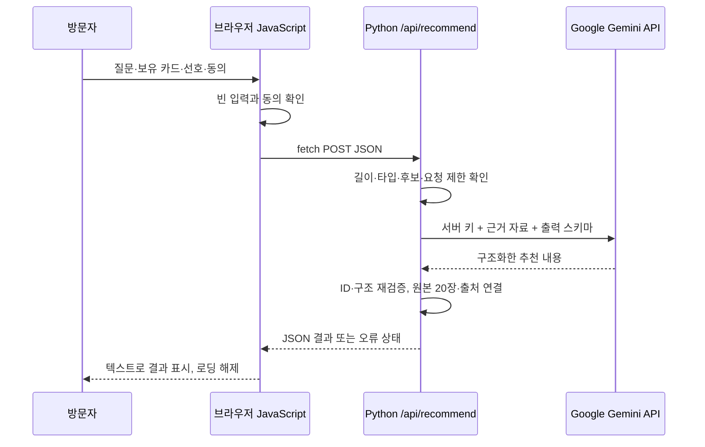

# 구조와 학습 설명

## HTML · CSS · JavaScript

- `public/index.html`: 제목·메뉴·폼·자료 영역 등 문서의 구조를 정의합니다. `label for`가 입력과 연결되고, 결과 영역에는 `aria-live`를 둡니다.
- `public/css/styles.css`: 색상·글자·간격·grid·화면 크기에 따른 열 수를 정합니다. 720px 이하에서는 상담 폼과 결과가 한 열로 바뀝니다.
- `public/js/app.js`: 메뉴/hash, 자료 불러오기, 검색/필터, 즐겨찾기, 폼 검증과 API 요청, 결과/오류 DOM 갱신을 담당합니다. 프레임워크 없이 브라우저 표준 API를 사용합니다.

## 입력부터 결과까지

`fetch`는 비동기 네트워크 요청입니다. `await response.json()`으로 응답 본문을 JavaScript 객체로 바꿉니다. HTTP 오류(예: 503)는 fetch 자체의 예외가 아니므로 `response.ok`를 검사합니다. 네트워크 오류와 시간 초과는 catch에서 따로 안내합니다. finally에서 버튼과 로딩 상태를 복구합니다.

## Python Vercel Function

`api/recommend.py`는 `BaseHTTPRequestHandler`의 `handler` 클래스를 정의합니다. Vercel의 파일 기반 Python 함수가 `/api/recommend` 요청에 매핑합니다. 프레임워크 preset을 추가하면 라우팅 방식이 달라질 수 있어 이 프로젝트에는 Flask/FastAPI를 설치하지 않습니다.

`backend/coach.py`가 실제 AI 호출을 담당합니다. 서버 함수는 요청마다 실행될 수 있고 프로세스가 재사용되거나 여러 개 생길 수 있습니다. 따라서 전역 딕셔너리의 요청 제한은 인스턴스별 보호이며 영속 DB나 전역 요금 제한이 아닙니다.

## 왜 API 키는 환경 변수인가요?

브라우저의 HTML/JS와 네트워크 요청은 방문자가 볼 수 있습니다. 거기에 키가 있으면 다른 사람이 키를 사용해 비용을 발생시킬 수 있습니다. 이 서비스는 브라우저가 같은 도메인의 Python 함수만 호출하고, Python이 `GEMINI_API_KEY`를 읽어 Google Gemini 요청의 x-goog-api-key 헤더에 붙입니다. 키를 브라우저 응답·로그·GitHub에 담지 않습니다. `.env.local`은 개발 편의 파일이며 `.gitignore`에 포함됩니다.

## 로컬과 배포 환경

| 항목 | 로컬 | Vercel |
|---|---|---|
| 실행 | Python `scripts/serve.py` | 정적 파일 + 파일 기반 Serverless Function |
| 주소 | 127.0.0.1:5310 | 실제 생성된 https Vercel URL |
| 환경 변수 | OS 환경 또는 `.env.local` | 프로젝트 Environment Variables |
| 자료 파일 | backend/catalog.json | includeFiles로 함수에 포함 |
| 로그/확인 | 터미널·브라우저 개발자 도구 | Deployment/Function Logs·공개 URL |

배포 후 오류를 발견하면: 재현 → 브라우저 Network에서 상태 코드 확인 → 함수 로그에서 비밀 없는 오류 종류 확인 → 원인 수정 → 테스트 → Git 커밋/푸시 → Vercel 재배포 → 공개 URL에서 같은 조건 재검증.

## 설명할 수 있는 실제 문제 해결

- 기본 `http.server`로 HTML만 열면 API는 실행되지 않습니다. 정적 파일과 Python 엔드포인트를 함께 처리하는 `scripts/serve.py`를 사용합니다.
- 로컬 HTTP 테스트가 처음에는 운영 환경의 네트워크 권한 제한으로 실패했습니다. 연결 권한을 허용한 동일 테스트에서는 통과했습니다. 앱 코드 오류와 실행 환경 제한을 구분했습니다.
- AI 키가 없으면 예시를 실제 AI 응답처럼 돌려주지 않고 503으로 명확히 안내합니다. 테스트에서는 제공자를 가짜 응답으로 교체해 오류/성공 경로를 확인하고, 실제 AI 검증은 별도로 남깁니다.

## 공식 참고

- [Gemini 구조화 출력](https://ai.google.dev/gemini-api/docs/structured-output)
- [Gemini 모델](https://aistudio.google.com/docs/models/gemini-3.5-flash-lite)
- [Vercel Python /api 함수](https://vercel.com/docs/functions/runtimes/python/api-directory)
- [Vercel Python 런타임](https://vercel.com/docs/functions/runtimes/python)

문서 확인 2026-11-16. API/플랫폼 변경 시 공식 문서와 설정을 다시 대조합니다.

